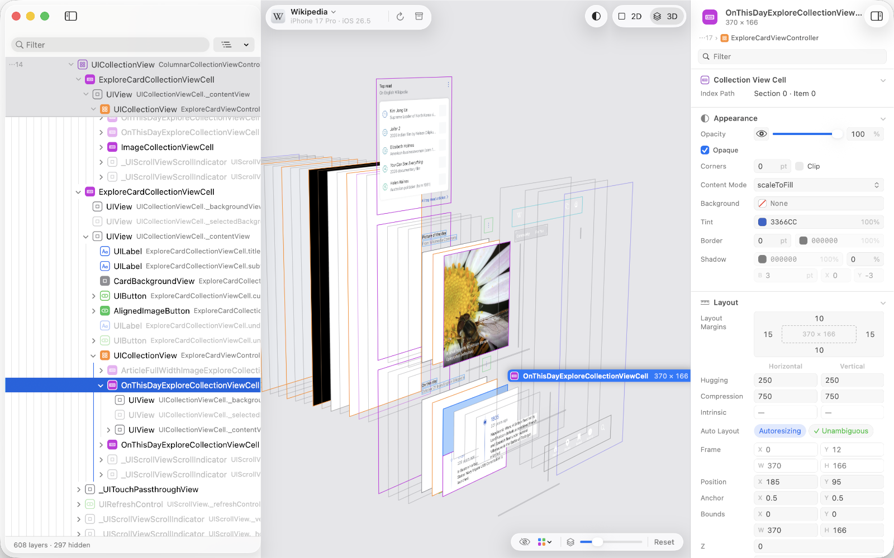

<p align="center">
  <picture>
    <source media="(prefers-color-scheme: dark)" srcset="Resources/readme/cutaway-client-dark.svg">
    
  </picture>
</p>

[](https://swift.org)
[](#requirements)
[](LICENSE)
[](https://github.com/nothingsh/Cutaway/actions/workflows/check.yml)

**English** | [简体中文](Resources/readme/README.zh-Hans.md) | [繁體中文](Resources/readme/README.zh-Hant.md) | [日本語](Resources/readme/README.ja.md) | [한국어](Resources/readme/README.ko.md) | [Español](Resources/readme/README.es.md) | [Français](Resources/readme/README.fr.md) | [Deutsch](Resources/readme/README.de.md)

Cutaway is a macOS app for looking inside the interface of a running iOS app. Add
[CutawayServer](https://github.com/nothingsh/CutawayServer) to your app, run it in the Simulator or
on a device connected over USB, and Cutaway lists it. Choose it, and Cutaway shows the app's layer
tree, a screenshot of every layer laid out in 2D or spread apart in 3D, and the attributes and Auto
Layout constraints of whichever layer you select. Edits you make to attributes are applied to the
running app.

<p align="center">
  <picture>
    <source media="(prefers-color-scheme: dark)" srcset="Resources/readme/overview-dark.png">
    
  </picture>
</p>

## Features

- **See how the interface is built.** The layer tree of every window, with view controllers and the member variables that hold each view marked. [The layer list](https://nothingsh.github.io/Cutaway/guide/hierarchy)
- **Take it apart in 3D.** A screenshot of every layer, flat in 2D or spread apart in 3D; turn, zoom and change the spacing. [The preview](https://nothingsh.github.io/Cutaway/guide/preview)
- **Measure.** Hold ⌥ and point at another layer, in the preview or in the list, to see the distances in points. [Measuring](https://nothingsh.github.io/Cutaway/guide/measuring)
- **Change it while it runs.** Edit attributes and they apply in the running app at once; ⌘Z undoes them. [Attributes](https://nothingsh.github.io/Cutaway/guide/attributes)
- **Follow the constraints.** Every Auto Layout constraint of a view, the ones not in effect marked, and their other ends. [Constraints](https://nothingsh.github.io/Cutaway/guide/constraints)
- **Try dark mode and larger text.** Override the app’s appearance, text size, layout direction and size classes. [Environment](https://nothingsh.github.io/Cutaway/guide/environment)
- **Jump to your code.** Open a class in Xcode, see asset and string catalog names, copy an LLDB command. [Source code](https://nothingsh.github.io/Cutaway/guide/source)
- **Keep what you found.** Save an inspection and open it on any Mac without the device; export a layer as PNG. [Archives and export](https://nothingsh.github.io/Cutaway/guide/archives)

Cutaway talks only to apps on this Mac and over the USB cable: no analytics, no crash reports.
It is in English, Simplified Chinese, Traditional Chinese, Japanese and Korean.

## Requirements

- macOS 14 or later, on a Mac with a GPU that supports Metal (every Mac that runs macOS 14).
- An app that includes [CutawayServer](https://github.com/nothingsh/CutawayServer), running in
  the iOS Simulator or on an iPhone or iPad connected to the Mac over USB.

## Installation

Download `Cutaway-<version>.dmg` from the [Releases](https://github.com/nothingsh/Cutaway/releases) page, open it and drag
Cutaway to Applications. Cutaway is open source and its builds are not notarized by Apple, so the
first time you open it macOS says it cannot verify the developer. Open **System Settings › Privacy
& Security** and choose **Open Anyway**, or run:

```sh
xattr -dr com.apple.quarantine /Applications/Cutaway.app
```

**Cutaway › Check for Updates…** tells you when a newer release is out.

## Quick Start

1. Add [CutawayServer](https://github.com/nothingsh/CutawayServer) to your iOS app and call `CutawayServer.start()` once at launch. It is
   compiled only into Debug builds.
2. Run your app in the Simulator, or on a device connected to the Mac with a cable.
3. Open Cutaway. Your app appears in the list within a few seconds. Choose it.

The [getting started guide](https://nothingsh.github.io/Cutaway/guide/getting-started) has every step, the code for UIKit and
SwiftUI, and what to check when your app does not appear.

## Documentation

Everything else is on the [Cutaway website](https://nothingsh.github.io/Cutaway/):

- [Guide](https://nothingsh.github.io/Cutaway/guide/getting-started): using Cutaway, task by task, and every [keyboard shortcut](https://nothingsh.github.io/Cutaway/guide/shortcuts).
- [Integrate](https://nothingsh.github.io/Cutaway/integrate/): adding CutawayServer to your app, Debug and Release builds, and showing your app’s own details.
- [Protocol](https://nothingsh.github.io/Cutaway/protocol/): how Cutaway and CutawayServer talk, and which versions work together.
- [FAQ and troubleshooting](https://nothingsh.github.io/Cutaway/resources/faq), [Privacy and security](https://nothingsh.github.io/Cutaway/resources/privacy), [Performance](https://nothingsh.github.io/Cutaway/resources/performance), [Release notes](https://nothingsh.github.io/Cutaway/resources/releases), [Roadmap](https://nothingsh.github.io/Cutaway/resources/roadmap).

## Development

How to build and test Cutaway, and how changes are reviewed, is in [CONTRIBUTING.md](CONTRIBUTING.md).
The [Contributing](https://nothingsh.github.io/Cutaway/resources/contributing) page explains how the three repositories fit together.

## License

Cutaway is free software, released under the GNU General Public License v3.0; see
[LICENSE](LICENSE). It is built with [FlatBuffers](https://github.com/google/flatbuffers) (Apache
License 2.0), [DeclarativeAppKit](https://github.com/nothingsh/DeclarativeAppKit) (MIT) and
[DeclarativeCombine](https://github.com/nothingsh/DeclarativeCombine) (MIT); their licenses are in
the About panel and in [`CutawayKit/Sources/CutawayUI/Resources/Acknowledgements`](CutawayKit/Sources/CutawayUI/Resources/Acknowledgements). The [Cutaway protocol](https://github.com/nothingsh/CutawayProtocol) is under the
MIT License.
